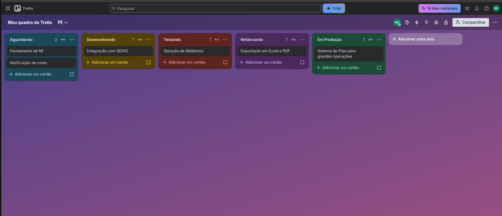

# Trabalho 3

## Board no Trelo
Link:
https://trello.com/b/6n9UZGS3/meu-quadro-do-trello

## Demonstração do Board:

| Tarefa | Aguardando desenvolvimento | Em desenvolvimento | Em testes | Refatorando | Entregue |
| --- | --- | --- | --- | --- | --- |
| Explicação | Aguardando dev fazer o pull | Task sendo desenvolvida | Tarefa sendo testada | Código sendo melhorado | Código em produção |
| WIP | 4 | 2 | 2 | 2 | No limit |
| Labels | Aguardando | Desenvolvendo | Testando | Refatorando | Em Produção |

## Template de Exemplo: 

### Geração de Nota Fiscal:

- Objetivo: 
> Como usuario quero gerar nota fiscal de acordo com a composição de cada serviço prestado na empresa.
- Critério de aceitação:
    - A NF deve ser gerada via integração com Sefaz
    - Quando gerada deve ser notificado que a nota foi emitida
    - Quando emitida a Nota deve ser enviada por e-mail para o respectivo cliente
    - Se der erro na emissão da nota deve ser notificado ao usuário responsavel pela emissão

- Observações e restrições:
    - O sistema deve aceitar varios tipos de Notas
    - O sistema deve dar ao usuario a responsabilidade de editar a composição do produto ou serviço para emissão da nota
    - Não é necessário integração com sistemas de prefeitura nesse objetivo

- Definição de Pronto:
    - Integração com o Sefaz funcionando
    - Campos de edição de composição de serviços e produtos
    - Geração de relatório e fechamento.

### Itens do Fluxo

- Sistemas de Filas:
    - As filas vão ficar responsaveis para as grandes operações.
    - No caso das NF os eventos de relatório e fechamento entraram em uma fila para que sejam processados.

- Exportação em Excel e PDF
    - Os relatórios devem ser exportados em dois formatos de arquivo (PDF e Excel)

- Geração de Relatórios
    - Uma função para geração de relatórios de notas fiscais emitadas em um periodo determinado pelo usuario.

- Integração com o Sefaz
    - Integração completa com o sistema do Sefaz para que as notas sejam enviadas para serem enviadas para emissão e a resposta seja processada para que o usuario saiba se a nota enviada foi emitida ou deu falha.

- Fechamento de NF
    - A opção de fechamento deve disponibilizar ao usuarios baixar uma pasta .zip com todas as notas (XML e PDF) emitidas em um período determinado pelo usuário. 

- Notificação de notas
    - Sistema que notifica os retornos do Sefaz para o usuario

### Evidencias de uso do Fluxo

### Breve justificativa da configuração

